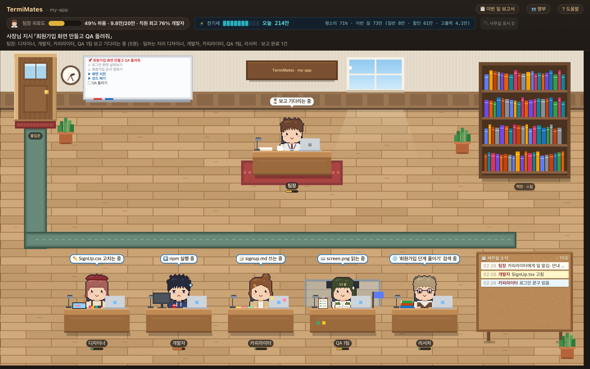
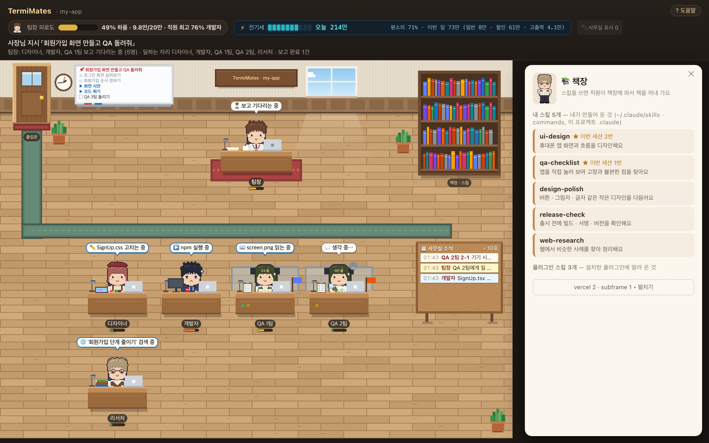
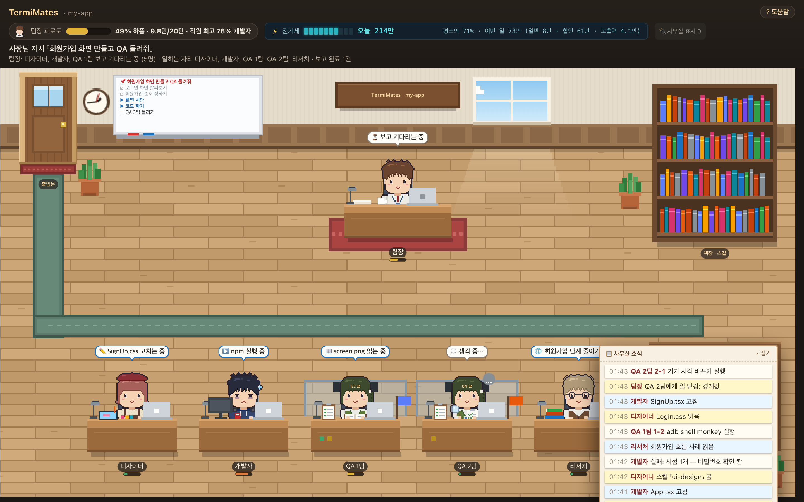

<div align="center">

# 🏢 TermiMates

**Claude Code 가 일하는 모습을 픽셀 사무실로 보여 주는 플러그인**

Claude 에게 일을 시키면 팀장 · 기획자 · 디자이너 · 개발자 · QA 가 출근해서 일하고, 서류를 넘기고, 퇴근해요.<br>
AI 가 지금 무엇을 하는지, 누구에게 일을 나눴는지, 토큰을 얼마나 쓰는지 **한눈에** 보여요.

`토큰 0` · `방해 0` · `내 컴퓨터에만 기록` · `MIT`



</div>

---

## ✨ 이런 걸 보여 줘요

| | |
|---|---|
| 👔 **팀장 = 지금 대화하는 Claude** | 사장님(나)의 지시를 받으면 사장님이 문으로 들어와 지시서를 건네요. 팀장이 생각하고, 일을 나눠요. |
| 🚪 **직원 = 일을 맡은 AI** | 서브에이전트를 부르면 직원이 문으로 출근해 자리에 앉아요. 이름은 쉬운 말로 — 기획자 · 디자이너 · 개발자 · QA · 리서처. |
| 👥 **팀은 한 자리** | 「QA 3팀 × 3명」 처럼 여러 명을 돌려도 사무실엔 팀마다 한 자리. 팀원은 차례로 출근하고, 책상 앞 점으로 진행이 보여요. |
| 📄 **서류 전달** | 일을 끝낸 직원은 서류를 들고 팀장 책상까지 걸어가 건네고, 문으로 퇴근해요. |
| 📚 **책장 = 스킬** | 스킬을 쓰면 직원이 책장에 가서 그 책을 꺼내 와 읽어요. 책장을 누르면 내 스킬 목록과 한 줄 설명. |
| 💤 **피로도 = 대화가 찬 정도** | 팀장도 직원도 각자 따로. 차오르면 하품 → 땀 → zzz. 누르면 「/compact 할까? 기록하고 /clear 할까?」 정리 안내. |
| ⚡ **전기세 = 토큰** | 이번 일 · 오늘 합계 · 평소 대비. 새로 읽음 · 다시 읽음(할인) · 써냄 으로 나눠서. |
| 🖥️ **누르면 「지금 화면」** | 직원을 누르면 그 사람 모니터처럼 — 실행 중인 명령, 고치는 파일, 방금 한 일. |
| 💬 **말 걸기** | 직원을 눌러 바로 말을 걸 수 있어요 (보낼 때만 토큰이 들어요). |

<table>
<tr>
<td width="50%"><br><sub>직원(팀)을 누르면 「지금 화면」 · 팀원 · 피로도 · 전기세 몫 — 밤엔 스탠드가 켜져요</sub></td>
<td width="50%"><br><sub>책장을 누르면 내 스킬 / 플러그인 스킬과 한 줄 설명</sub></td>
</tr>
<tr>
<td width="50%"><br><sub>책장 밑 「사무실 소식」 게시판 — 접으면 3줄, 누르면 10줄</sub></td>
<td width="50%"><br><sub>Claude Code 대화창 바로 옆 패널 — 「QA 3팀 × 3명」 시연 중, 처음엔 사용법 안내가 떠요</sub></td>
</tr>
</table>

---

## 🚀 설치 (1분)

**Claude Code 안에서** 두 줄이면 끝이에요.

```
/plugin marketplace add jusung2/termimates-office
/plugin install termimates@termimates
```

그다음 **Claude Code 를 새로 켜면** 처음 한 번 사무실이 열리면서 사용법 안내가 나와요.
그 뒤로는 언제든 이 명령 하나로 켜고 꺼요.

```
/termimates
```

> 💡 처음엔 `/termimates 시연` 으로 가짜 장면부터 구경해 보세요. Claude 를 부르지 않아서 토큰이 하나도 안 들어요.

### 명령

| 명령 | 하는 일 |
|---|---|
| `/termimates` | 사무실 패널 열기 · 닫기 (켜 둔 프로젝트는 다음에도 열려요) |
| `/termimates 시연` | 「회원가입 화면 만들어줘」 가짜 장면 (약 70초, 토큰 0) |
| `/termimates 시연 qa` | 「QA 3팀 × 3명」 가짜 장면 — 팀이 어떻게 보이는지 |
| `/termimates 웹` | 브라우저에서 큰 사무실 → `http://127.0.0.1:8766` 을 여세요 |
| `/termimates 도움말` | 사용법 안내 다시 보기 |

---

## 🗺️ 화면 읽는 법

```
[벽: 출입문 · 시계 · 화이트보드(사장님 지시 · 할 일) · 회사 간판 · 창문]   [📚 책장]
                     👔 팀장 (책상 · 깔개)
 🚪 ─────────────────────── 큰 복도 (카펫) ───────────────────────
   디자이너   개발자   QA 1팀   QA 2팀   리서처 …              [📋 사무실 소식]
```

- **말풍선** — 지금 하는 일 (✏️ 고치는 중 · ▶️ 실행 중 · 📖 읽는 중 · 🔍 찾는 중 · 📚 스킬)
- **머리 옆 표시** — `!` 새 일 · `…` 생각 중 · `?` 질문 · `✓` 끝 · 빨간 `!` 실패
- **이름표 밑 작은 막대** — 그 직원의 피로도 (초록 → 노랑 → 주황 → 빨강)
- **맨 위** — 팀장 피로도(누르면 정리 안내) · 전기세 · 사장님 지시 · 지금 상황
- **낮 · 밤** — 창밖 하늘이 바뀌고, 밤엔 방이 어두워지며 사람이 있는 책상의 스탠드가 켜져요

### 피로도가 차면?

피로도 = 지금 대화에 쌓인 양이 최대치의 몇 % 인지. **Claude 는 대답할 때마다 지금까지 대화를 처음부터 다시 읽어요.** 그래서 쌓일수록 한 번 움직일 때 전기세(토큰)가 더 나와요.

> 예) 로그인 화면을 한참 만들어 대화가 10만 토큰 쌓인 상태에서 상관없는 「정산 기능 만들어 줘」 를 시키면, 정산 일을 하는 한 걸음마다 로그인 이야기 10만 토큰을 또 읽어요. 새 일이면 `/clear` 로 새 대화를 열고 시키는 게 싸요.

| 단계 | 할 일 |
|---|---|
| 🟢 쌩쌩 (~40%) | 그대로 일하면 돼요 |
| 🟡 하품 (40~70%) | 하던 일을 이어 가면 그대로 OK. **상관없는 새 일**을 시킬 땐 `/clear` 로 새 대화를 열고 — 쌓인 대화를 매번 다시 읽는 토큰을 아껴요 |
| 🟠 피곤 (70~90%) | 같은 일을 이어 갈 거면 `/compact`, 다른 일이면 **지금까지 한 일을 파일에 적게 한 뒤** `/clear` |
| 🔴 녹초 (90%~) | 곧 Claude 가 알아서 정리(자동 compact)해요 — 그 전에 위처럼 |

패널에서 피로도를 누르면 이 안내와 함께 **입력창에 글만 넣어 주는 단추**(정리 부탁 문장 · `/compact` · `/clear`)가 나와요. Enter 는 직접 누르니까 누르기 전엔 토큰 0.

직원(서브에이전트)은 팀장과 **따로 자기 대화**를 들고 일해서 피로도도 각자 따로예요. 일이 끝나 퇴근하면 그 대화는 버려지고, 다음 직원은 0% 부터 시작해요.

---

## 🔒 토큰 0 · 방해 0 · 내 컴퓨터에만

- 사무실은 **AI 를 부르지 않아요.** Claude Code 가 이미 알고 있는 것(도구 호출 · 에이전트 · 토큰 숫자)만 보고 그려요. 표시 비용 **0 토큰**.
- 모든 훅은 **보기만** 하고 그대로 넘겨요. 실패해도 Claude 작업은 그대로 가요.
- 토큰이 드는 건 사람이 직접 누를 때뿐 — 「말 걸기」 로 보낼 때.
- 기록은 이 컴퓨터에만 (`~/.termimates/`). 웹 사무실 서버는 `127.0.0.1` 에서만 열리고 밖으로 보내는 게 없어요.

---

## 🧰 필요한 것

- **Claude Code** — 플러그인 패널(mod)을 지원하는 최신 버전 (2.1.332 에서 확인)
- **넓은 터미널** — 패널은 대화창 옆에 붙어요. 좁으면 아래에 붙어요.
- **python3** — `/termimates 웹` 을 쓸 때만 (macOS 기본 포함. 없으면 macOS 가 개발자 도구 설치 창을 띄워요). 패널은 python 없이도 돼요.

## ❓ 자주 묻는 것

<details>
<summary><b>사무실이 안 열려요</b></summary>

`/termimates` 를 쳐 보세요. 처음 한 번만 저절로 열리고, 그 뒤로는 프로젝트마다 마지막에 켜 뒀던 곳만 다시 열려요.
설치 직후라면 Claude Code 를 새로 켜거나 `/reload-plugins`.
</details>

<details>
<summary><b>왜 「개발자」 로 나와요? 내가 만든 에이전트 이름이 있는데</b></summary>

에이전트 종류 이름의 낱말로 쉬운 역할을 골라요 (design → 디자이너, qa · test · review → QA, plan → 기획자, explore · research → 리서처, 그 밖 → 개발자). `general-purpose` 처럼 이름으로 알 수 없으면 맡긴 일 설명의 낱말로 골라요. 직원을 누르면 진짜 에이전트 이름도 보여요.
</details>

<details>
<summary><b>팀은 어떻게 알아봐요?</b></summary>

맡긴 일 설명 · 이름에 「1팀」, 「team 2」, 「1-2」(팀-번호) 같은 표시가 있으면 같은 팀으로 묶어 한 자리에 보여 줘요.
</details>

<details>
<summary><b>책장에 처음 보는 스킬이 많아요</b></summary>

「내 스킬」 은 내가 만든 것(`~/.claude/skills` · `commands`, 프로젝트 `.claude`)이고, 「플러그인 스킬」 은 설치한 플러그인에 딸려 온 것이에요. 플러그인별로 묶여 접혀 있어요.
</details>

<details>
<summary><b>내 스킬 한 줄 설명을 직접 쓰고 싶어요</b></summary>

기본은 각 스킬 설명(description)의 첫 문장이에요. 더 쉬운 말로 바꾸고 싶으면 내 컴퓨터에 `~/.termimates/skill-notes.json` 을 만들어 두세요. git 에 올리지 않는 내 설정이에요.

```json
{
  "my-skill": { "note": "쉬운 한 줄 설명", "role": "디자이너" }
}
```

`role` 은 그 스킬을 쓸 때 책장에 다녀올 직원(기획자 · 디자이너 · 개발자 · QA · 리서처 · 팀장)이에요. 안 적으면 이름 · 설명의 낱말로 골라요.
</details>

<details>
<summary><b>웹 사무실이 안 떠요</b></summary>

`/termimates 웹` 을 친 Claude Code 세션이 켜져 있는 동안만 서버가 돌아요. python3 가 있는지 확인하고, 브라우저에서 `http://127.0.0.1:8766` 을 직접 여세요.
</details>

---

## 🛠️ 만드는 사람을 위해

```
panel/                     # 플러그인 (mod)
├── hooks/register.tsx     # 훅 · 패널 화면 · /termimates 명령
├── hooks/office.ts        # 일어난 일 → 사무실 상태 (순수 함수, 시연과 같이 씀)
├── hooks/scene.ts         # 패널 픽셀 그림 (반칸 블록)
├── hooks/power.ts         # 전기세 · 피로도 계산 · 안내
├── hooks/words.ts         # 쉬운 말 · 역할 · 팀 알아보기
├── hooks/skills.ts        # 스킬 한 줄 설명 · 담당
├── hooks/demo.ts          # 시연 장면
├── web/                   # 웹 사무실 (serve.py · office.js · sprites.js 48×64 캐릭터)
└── tests/                 # claude plugin test
scripts/                   # 미리보기 · 웹 연기 시험 (창 없이)
```

```bash
claude plugin validate panel     # 검사
claude plugin test panel         # 시험
node scripts/web-smoke.mjs       # 웹 그림 코드 오류 확인 (창 없이)
```

이슈 · 아이디어 환영해요.

## 📄 라이선스

[MIT](LICENSE)
