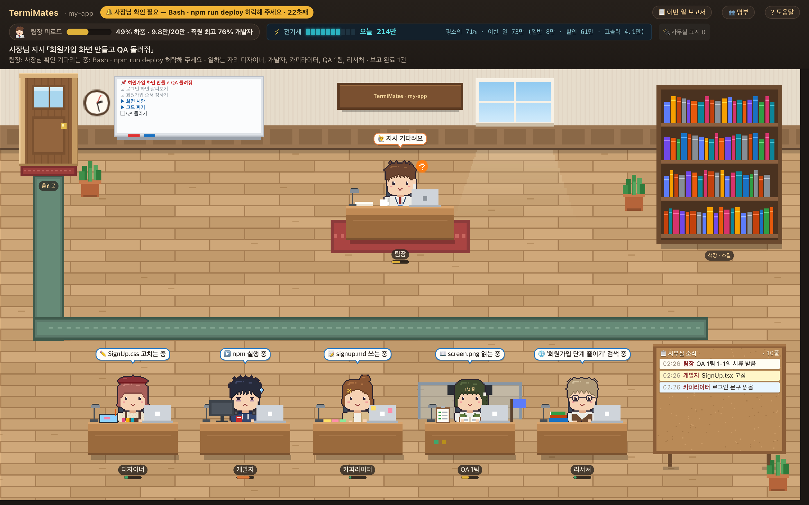
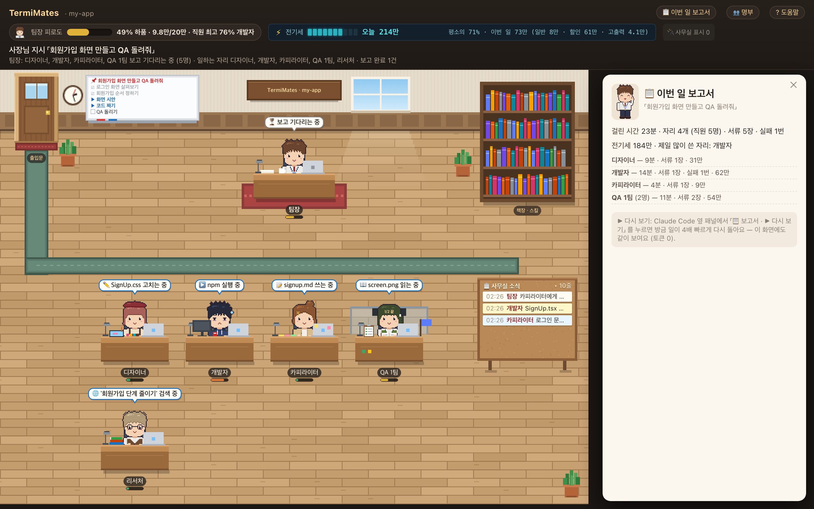
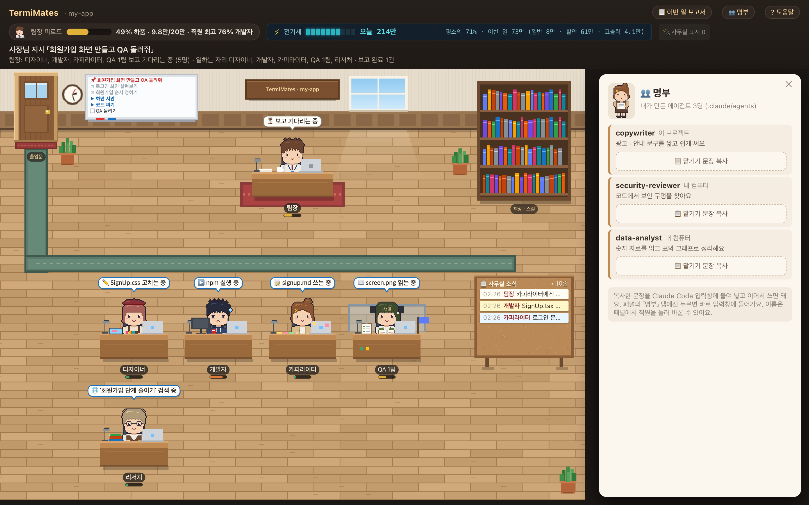
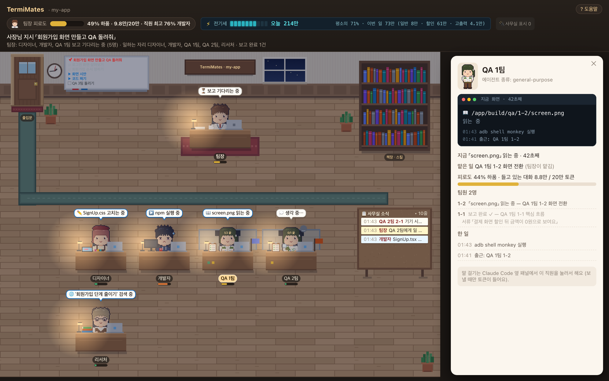
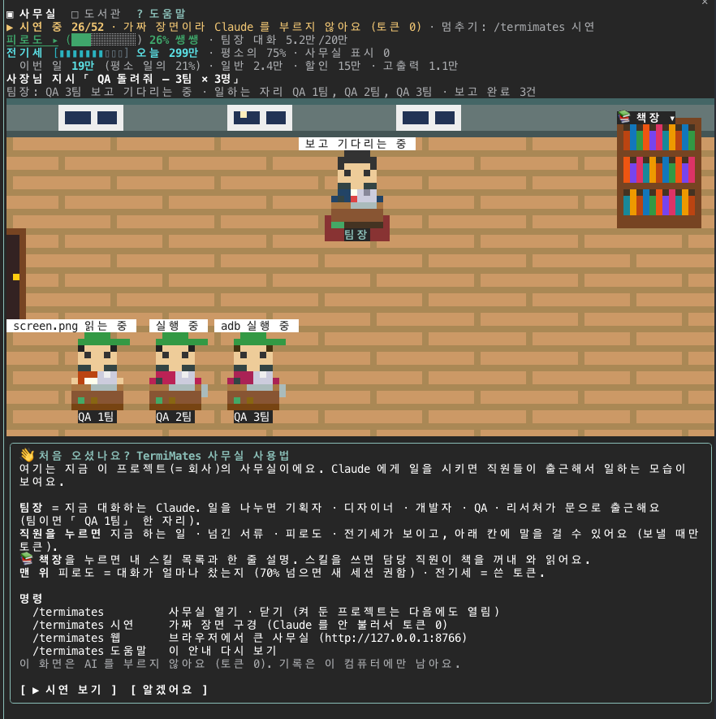

<div align="center">

# 🏢 TermiMates

**Claude Code 가 일하는 모습을 픽셀 사무실로 보여 주는 플러그인**

Claude 에게 일을 시키면 팀장과 직원들(기획자 · 디자이너 · 개발자 · QA … **내가 지은 이름은 그대로**)이<br>
출근해서 일하고, 서류를 넘기고, 퇴근해요. AI 가 지금 무엇을 하는지, 누구에게 일을 나눴는지,<br>
토큰을 얼마나 쓰는지 **한눈에** 보이고 — 허락이 필요하면 **불러 주고**, 일이 끝나면 **보고서**를 내요.

`토큰 0` · `방해 0` · `내 컴퓨터에만 기록` · `MIT`


</div>

---

## ✨ 이런 걸 보여 줘요

| | |
|---|---|
| 👔 **팀장 = 지금 대화하는 Claude** | 사장님(나)의 지시를 받으면 사장님이 문으로 들어와 지시서를 건네요. 팀장이 생각하고, 일을 나눠요. |
| 🚪 **직원 = 일을 맡은 AI** | 서브에이전트를 부르면 직원이 문으로 출근해 자리에 앉아요. 기본 에이전트는 쉬운 말로(기획자 · 디자이너 · 개발자 · QA · 리서처), **내가 지은 이름은 그대로**(`designer` · `executor` 처럼 흔한 표준 이름만 디자이너 · 개발자 같은 쉬운 역할로) — 이름은 언제든 바꿀 수 있어요. **청록 깔개 · 「같은 일 ×n」** = 같은 일을 나눠서 동시에 하는 직원들이에요. |
| 👥 **팀은 한 자리** | 「QA 3팀 × 3명」 처럼 여러 명을 돌려도 사무실엔 팀마다 한 자리. 팀원은 차례로 출근하고, 책상 앞 점으로 진행이 보여요. |
| 📄 **서류 전달** | 일을 끝낸 직원은 서류를 들고 팀장 책상까지 걸어가 건네고, 문으로 퇴근해요. |
| 📚 **책장 = 스킬** | 스킬을 쓰면 직원이 책장에 가서 그 책을 꺼내 와 읽어요. 책장을 누르면 내 스킬 목록과 한 줄 설명. |
| 💤 **피로도 = 대화가 찬 정도** | 팀장도 직원도 각자 따로. 차오르면 하품 → 땀 → zzz. 누르면 「/compact 할까? 기록하고 /clear 할까?」 정리 안내. |
| ⚡ **전기세 = 토큰** | 이번 일 · 오늘 합계 · 평소 대비. 새로 읽음 · 다시 읽음(할인) · 써냄 으로 나눠서. |
| 🖥️ **누르면 「지금 화면」** | 직원을 누르면 그 사람 모니터처럼 — 실행 중인 명령, 고치는 파일, 방금 한 일. |
| 💬 **말 걸기** | 직원을 눌러 바로 말을 걸 수 있어요 (보낼 때만 토큰이 들어요). |
| 🔔 **사장님 호출** <sup>NEW</sup> | Claude 가 **허락**(명령 실행 · 파일 고치기)이나 **질문의 답**을 기다리면 맨 위에 노란 줄이 뜨고 그 사람이 손을 들어요. 12초 넘게 그대로면 **알림**도 보내요 — 다른 창에서 일하다 놓치지 않게. 5분 넘게 같은 일에 머무는 직원은 ⏳ 로 알려 줘요. |
| 📋 **이번 일 보고서** <sup>NEW</sup> | 일이 끝나면 한 장으로 — 걸린 시간 · 자리별 사람 수 · 서류 · 실패 · 전기세, 제일 많이 쓴 자리. |
| ▶ **다시 보기** <sup>NEW</sup> | 방금 한 일을 **4배 빠르게** 사무실에서 다시 틀어 줘요. 자리를 비웠을 때 무슨 일이 있었는지 확인하기 좋아요 (토큰 0). |
| 👆 **누르면 바로 시키기** <sup>NEW</sup> | 책장의 스킬 「쓰기 ▸」 → 입력창에 `/스킬이름` · 명부의 에이전트 「맡기기 ▸」 → 입력창에 부탁 문장. **Enter 는 직접** 누르니까 그 전엔 토큰 0. |
| 👥 **명부** <sup>NEW</sup> | 내가 만든 에이전트(`.claude/agents`) 목록과 한 줄 설명. 이 프로젝트 것 · 내 컴퓨터 것을 나눠 보여 줘요. |

<table>
<tr>
<td width="50%"><br><sub>🔔 허락을 기다리면 맨 위 노란 줄 + 팀장이 손을 들어요 (12초 넘으면 알림)</sub></td>
<td width="50%"><br><sub>📋 일이 끝나면 보고서 — 시간 · 사람 · 서류 · 실패 · 전기세</sub></td>
</tr>
<tr>
<td width="50%"><br><sub>👥 명부 — 내가 만든 에이전트와 「맡기기」 (사무실의 「카피라이터」 처럼 내 이름 그대로 출근해요)</sub></td>
<td width="50%"><br><sub>직원(팀)을 누르면 「지금 화면」 · 팀원 · 피로도 · 전기세 몫 — 밤엔 스탠드가 켜져요</sub></td>
</tr>
<tr>
<td width="50%"><br><sub>책장을 누르면 내 스킬 / 플러그인 스킬과 한 줄 설명 — 줄을 누르면 <code>/스킬</code> 복사</sub></td>
<td width="50%"><br><sub>책장 밑 「사무실 소식」 게시판 — 최근 3줄, 누르면 옆에 전체 목록</sub></td>
</tr>
<tr>
<td width="50%"><br><sub>Claude Code 대화창 바로 옆 패널 — 「QA 3팀 × 3명」 시연 중, 처음엔 사용법 안내가 떠요</sub></td>
<td width="50%">

**패널에서 일이 끝나면**

```
✅ 이번 일 끝 · 📋 보고서 · ▶ 다시 보기

📋 이번 일 보고서 — 「회원가입 화면 만들고 QA 돌려줘」
걸린 시간 23분 · 자리 4개 (직원 5명)
서류 5장 · 실패 1번
전기세 184만 · 제일 많이 쓴 자리: 개발자
  · 디자이너 — 9분 · 서류 1장 · 31만
  · 개발자 — 14분 · 서류 1장 · 실패 1번 · 62만
  · 카피라이터 — 4분 · 서류 1장 · 9만
  · QA 1팀 (2명) — 11분 · 서류 2장 · 54만

[ ▶ 다시 보기 (4배 빠르게) ]  [ 닫기 ]
```

</td>
</tr>
</table>

---

## 🚀 설치 (1분)

**Claude Code 안에서** 두 줄이면 끝이에요.

```
/plugin marketplace add jusung2/termimates-office
/plugin install termimates@termimates
```

그다음 **Claude Code 를 새로 켜면** 처음 한 번 사무실이 열리면서 사용법 안내가 나와요.
그 뒤로는 언제든 이 명령 하나로 켜고 꺼요.

```
/termimates
```

> 💡 처음엔 `/termimates 시연` 으로 가짜 장면부터 구경해 보세요. Claude 를 부르지 않아서 토큰이 하나도 안 들어요.

### 명령

| 명령 | 하는 일 |
|---|---|
| `/termimates` | 사무실 패널 열기 · 닫기 (켜 둔 프로젝트는 다음에도 열려요) |
| `/termimates 시연` | 「회원가입 화면 만들어줘」 가짜 장면 (약 70초 · 검토하는 동안 「QA 1팀」 팀 묶음도, 토큰 0) |
| `/termimates 웹` | 브라우저에서 큰 사무실 (`http://127.0.0.1:8766` 이 저절로 열려요) |
| `/termimates 도움말` | 사용법 안내 다시 보기 |

패널 맨 위 탭: **사무실** · **도서관**(스킬 전체 · 「쓰기」) · **명부**(내 에이전트 · 「맡기기」) · **? 도움말**

---

## 🗺️ 화면 읽는 법

```
[벽: 출입문 · 시계 · 화이트보드(사장님 지시 · 할 일) · 회사 간판 · 창문]   [📚 책장]
                     👔 팀장 (책상 · 깔개)
 🚪 ─────────────────────── 큰 복도 (카펫) ───────────────────────
   디자이너   개발자   QA 1팀   QA 2팀   리서처 …              [📋 사무실 소식]
```

- **말풍선** — 지금 하는 일 (✏️ 고치는 중 · ▶️ 실행 중 · 📖 읽는 중 · 🔍 찾는 중 · 📚 스킬)
- **머리 옆 표시** — `!` 새 일 · `…` 생각 중 · `?` 질문 · `✓` 끝 · 빨간 `!` 실패
- **이름표 밑 작은 막대** — 그 직원의 피로도 (초록 → 노랑 → 주황 → 빨강)
- **맨 위** — 팀장 피로도(누르면 정리 안내) · 전기세 · 🔔 사장님 확인 필요(있을 때만) · 사장님 지시 · 지금 상황
- **⏳ N분째 같은 일** — 한 직원이 5분 넘게 같은 일에 머물면 지금 상황 줄에 떠요. 막혔는지 한 번 눌러 보세요
- **낮 · 밤** — 창밖 하늘이 바뀌고, 밤엔 방이 어두워지며 사람이 있는 책상의 스탠드가 켜져요

### 📄 놓친 일 서류

짐작하지 않고 **흔적이 있는 것만** 그 일을 맡았던 자리 근처 바닥에 서류로 떨어뜨려요 (「사무실 소식」 에도 한 줄).

| 언제 | 흔적 |
|---|---|
| 팀장 · 직원의 차례가 끝났는데 그 사람이 적은 할 일 목록(`TodoWrite` · `TaskCreate`)에 **안 끝난 줄**이 남음 | 줄마다 한 장 |
| 「했어?」 · 「확인했어?」 처럼 물은 차례의 답에 **「놓쳤 · 깜빡 · 빠뜨렸 · 아직 안 했 · 못 했」** | 그 문장을 짧게 |
| 직원이 **중단됨** | 맡긴 일 |

서류를 누르면(터미널은 창을 고른 뒤 **숫자 키**나 Tab) 팀장이 걸어가 줍고 자리로 돌아와 확인한 뒤, 입력창에 **「놓친 일 다시 확인: ○○」** 을 넣어 줘요 — 보내기는 직접 (그 전엔 토큰 0). 웹에서 눌러도 같은 길로 패널이 입력창에 넣고, 못 넣으면 카드의 문장을 복사하면 돼요. 다시 확인을 넘기거나 그 줄이 나중에 끝나면 서류는 사라져요. 「오래 조용함」 같은 짐작으로는 안 만들어요.

### 피로도가 차면?

피로도 = 지금 대화에 쌓인 양이 최대치의 몇 % 인지. **Claude 는 대답할 때마다 지금까지 대화를 처음부터 다시 읽어요.** 그래서 쌓일수록 한 번 움직일 때 전기세(토큰)가 더 나와요.

> 예) 로그인 화면을 한참 만들어 대화가 10만 토큰 쌓인 상태에서 상관없는 「정산 기능 만들어 줘」 를 시키면, 정산 일을 하는 한 걸음마다 로그인 이야기 10만 토큰을 또 읽어요. 새 일이면 `/clear` 로 새 대화를 열고 시키는 게 싸요.

| 단계 | 할 일 |
|---|---|
| 🟢 쌩쌩 (~40%) | 그대로 일하면 돼요 |
| 🟡 하품 (40~70%) | 하던 일을 이어 가면 그대로 OK. **상관없는 새 일**을 시킬 땐 `/clear` 로 새 대화를 열고 — 쌓인 대화를 매번 다시 읽는 토큰을 아껴요 |
| 🟠 피곤 (70~90%) | 같은 일을 이어 갈 거면 `/compact`, 다른 일이면 **지금까지 한 일을 파일에 적게 한 뒤** `/clear` |
| 🔴 녹초 (90%~) | 곧 Claude 가 알아서 정리(자동 compact)해요 — 그 전에 위처럼 |

패널에서 피로도를 누르면 이 안내와 함께 **입력창에 글만 넣어 주는 단추**(정리 부탁 문장 · `/compact` · `/clear`)가 나와요. Enter 는 직접 누르니까 누르기 전엔 토큰 0.

직원(서브에이전트)은 팀장과 **따로 자기 대화**를 들고 일해서 피로도도 각자 따로예요. 일이 끝나 퇴근하면 그 대화는 버려지고, 다음 직원은 0% 부터 시작해요.

---

## 🏷️ 직원 이름 = 내 에이전트 이름

기획자 · 디자이너 · 개발자 · QA · 리서처 는 **기본 이름**일 뿐이에요. 사람마다 쓰는 에이전트가 다르니까 이름은 열려 있어요.

| 이런 에이전트면 | 사무실 이름표 |
|---|---|
| 내가 만든 에이전트 (`.claude/agents/copywriter.md` 등) | **그 이름 그대로** — `copywriter` |
| 흔한 표준 이름과 똑같은 에이전트 (`designer` · `executor` · `critic` · `planner` 처럼 플러그인이 깔아 둔 것) | 쉬운 역할 — 디자이너 · 개발자 · QA · 기획자 (`api-builder` · `ui-designer` 처럼 내가 지은 이름은 그대로) |
| 이름을 바꿔 둔 에이전트 | **내가 정한 이름** — 「카피라이터」 |
| `general-purpose` · `Explore` · `Plan` 같은 기본 에이전트 | 맡긴 일에 맞는 쉬운 역할 — 기획자 · 디자이너 · 개발자 · QA · 리서처 |

**이름 바꾸는 법 (둘 중 하나)**

1. **패널에서** — 사무실에서 그 직원을 누르고, 카드 아래 「이름 바꾸기」 칸에 새 이름을 쓰고 Enter. 이미 출근한 직원도 바로 바뀌고, 다음부터 계속 그 이름이에요.
2. **파일로** — `~/.termimates/roles.json` 에 한꺼번에 적어 두기 (여러 컴퓨터에 같은 이름을 쓸 때 편해요)

```json
{
  "copywriter": "카피라이터",
  "security-reviewer": "보안 담당",
  "data-analyst": "데이터 분석가"
}
```

왼쪽은 에이전트 종류 이름(파일 이름 · `name:`), 오른쪽은 이름표. 패널에서 바꾼 이름이 파일보다 먼저예요.
옷차림(캐릭터)은 이름 · 일의 낱말로 가까운 역할을 골라 입혀요 (예: 카피라이터 → 기획자 옷).

---

## 🔒 토큰 0 · 방해 0 · 내 컴퓨터에만

- 사무실은 **AI 를 부르지 않아요.** Claude Code 가 이미 알고 있는 것(도구 호출 · 에이전트 · 토큰 숫자)만 보고 그려요. 표시 비용 **0 토큰**.
- 모든 훅은 **보기만** 하고 그대로 넘겨요. 실패해도 Claude 작업은 그대로 가요.
- 토큰이 드는 건 사람이 직접 보낼 때뿐 — 「말 걸기」 로 보낼 때, 「쓰기 · 맡기기 · 정리 단추」 로 입력창에 넣은 글을 Enter 로 보낼 때.
- 🔔 알림은 Claude Code 의 알림 설정(`/config` 의 알림)을 따라 가요 — 터미널에 따라 맥 알림 또는 종소리.
- 보고서 · 다시 보기는 이 세션에서 있었던 일만 써요 (어디에도 보내지 않아요).
- 기록은 이 컴퓨터에만 (`~/.termimates/`). 웹 사무실 서버는 `127.0.0.1` 에서만 열리고 밖으로 보내는 게 없어요. 웹에서 받는 건 누른 「놓친 일 서류」 번호 하나뿐 (패널이 입력창에 문장만 넣고 보내지는 않아요).

---

## 🖥️ 지원 터미널

패널은 글자 칸에 색을 칠해 그려요(반칸 블록 `▀`). 이미지 기능은 쓰지 않아서, **24비트 색(트루컬러)을 지원하는 터미널이면** 그림이 나와요.

| 터미널 | 패널 | 비고 |
|---|---|---|
| **Orca** (macOS) | ✅ 확인함 | |
| **Warp** (macOS) | ✅ 확인함 | 이미지는 안 되지만 이 패널은 이미지를 안 써서 괜찮아요 |
| iTerm2 · Ghostty · kitty · WezTerm | 🟡 될 것으로 보여요 | 트루컬러 지원 터미널 — 아직 직접 확인 전 |
| macOS 기본 터미널 (Terminal.app) | 🟡 확인 전 | 트루컬러가 약하면 색이 거칠게 보일 수 있어요 |
| tmux 안 | 🟡 설정 필요 | 트루컬러가 통과하도록 설정해야 해요 (`set -ga terminal-overrides ",*:Tc"`) |
| Claude Code 데스크톱 앱 · VS Code 확장 | 📝 글자 목록 | 그림 대신 직원 목록으로 보여요 — 큰 그림은 `/termimates 웹` 으로 |

- **창 폭**: 넓으면(약 110칸 이상) 대화창 **옆**에, 좁으면 대화창 **위**에 붙어요. 넓을수록 보기 좋아요.
- **웹 사무실**(`/termimates 웹`)은 터미널과 상관없이 브라우저에서 보여요 (Chrome · Safari · Edge 등).
- 다른 터미널에서 써 보셨으면 잘 되는지 이슈로 알려 주세요 — 이 표에 더할게요.

### 🩹 사무실 화면이 깨질 때

| 이렇게 보이면 | 이렇게 해 보세요 |
|---|---|
| 그림이 **두 배로 넓어지거나** 칸이 밀려서 뒤죽박죽 | 터미널 설정에서 **「모호한 폭 문자를 넓게(Ambiguous width as wide / double width)」 를 끄세요.** 그림에 쓰는 `▀` 문자가 2칸으로 잡히면 이렇게 깨져요. (iTerm2: Profiles › Text › *Treat ambiguous-width characters as double width* 해제) |
| 가로 **줄무늬 · 틈**이 보여요 | **줄 간격(line height)을 1.0 (100%)** 으로 맞추세요. 줄 사이가 벌어지면 위아래 칸 사이에 틈이 생겨요. |
| 색이 **거칠거나 이상해요** (몇 가지 색으로 뭉개짐) | 트루컬러를 지원하는 터미널을 쓰세요 (위 표). tmux 안이면 `~/.tmux.conf` 에 `set -ga terminal-overrides ",*:Tc"` 를 넣고 tmux 를 다시 켜세요. 터미널에서 `echo $COLORTERM` 이 `truecolor` 면 OK. |
| 한글 · 이름표 글자가 **겹치거나 어긋나요** | 한글이 들어간 **고정폭 글꼴**(예: D2Coding, Sarasa Mono K, 네이버 나눔고딕코딩)을 쓰세요. |
| 패널이 **좁아서 잘려요** | 터미널 창을 넓히거나 글자 크기를 줄이세요(`⌘ -`). 넓으면(약 110칸↑) 대화창 옆에 붙어요. `/termimates` 두 번(닫았다 열기)도 도움이 돼요. |
| 업데이트했는데 **예전 그림** 그대로 | `/reload-plugins` 또는 Claude Code 를 새로 켜세요. 새 버전 받기: `/plugin marketplace update termimates` → `/plugin update termimates@termimates` |
| 그래도 깨져요 | `/termimates 웹` 으로 브라우저에서 보세요 (터미널과 상관없어요). 깨진 화면 사진(대화 내용은 가리고)과 터미널 이름을 **이슈**로 남겨 주시면 고칠게요. |

## 🧰 필요한 것

- **Claude Code** — 플러그인 패널(mod)을 지원하는 최신 버전 (2.1.332 에서 확인)
- **트루컬러 터미널** — 위 「지원 터미널」 표를 보세요. 넓은 창일수록 보기 좋아요.
- **python3** — `/termimates 웹` 을 쓸 때만 (macOS 기본 포함. 없으면 macOS 가 개발자 도구 설치 창을 띄워요). 패널은 python 없이도 돼요.

## ❓ 자주 묻는 것

<details>
<summary><b>사무실이 안 열려요</b></summary>

`/termimates` 를 쳐 보세요. 처음 한 번만 저절로 열리고, 그 뒤로는 프로젝트마다 마지막에 켜 뒀던 곳만 다시 열려요.
설치 직후라면 Claude Code 를 새로 켜거나 `/reload-plugins`.
</details>

<details>
<summary><b>내가 만든 에이전트 이름으로 보고 싶어요 · 이름을 바꾸고 싶어요</b></summary>

내가 지은 이름은 처음부터 그대로 나와요 (`designer` · `executor` 처럼 흔한 표준 이름만 디자이너 · 개발자 같은 쉬운 역할로). 바꾸려면 위 「🏷️ 직원 이름 = 내 에이전트 이름」 을 보세요 (패널에서 누르고 「이름 바꾸기」, 또는 `~/.termimates/roles.json`).
`general-purpose` 같은 기본 에이전트는 이름만으로는 무슨 일인지 몰라서 맡긴 일의 낱말로 쉬운 역할(design → 디자이너, qa · test · review → QA, plan → 기획자, explore · research → 리서처, 그 밖 → 개발자)을 골라요. 직원을 누르면 진짜 에이전트 종류도 보여요.
</details>

<details>
<summary><b>🔔 알림이 안 와요 · 너무 자주 와요</b></summary>

허락 창이나 질문이 **12초 넘게** 그대로일 때 한 번만 보내요. 알림 방식은 Claude Code 설정(`/config` → 알림)을 따라 가요. 자동 모드에서 판정기가 알아서 정하는 건 사람을 부르지 않아요.
</details>

<details>
<summary><b>「다시 보기」 는 Claude 를 다시 돌리나요?</b></summary>

아니요. 일하는 동안 사무실에 일어난 일(출근 · 도구 · 서류 · 퇴근)을 적어 뒀다가 그림만 다시 틀어요. 토큰 0, 파일도 안 건드려요. 새 지시를 하면 지난 기록은 지워지고 새로 적어요.
</details>

<details>
<summary><b>팀은 어떻게 알아봐요?</b></summary>

맡긴 일 설명 · 이름에 「1팀」, 「team 2」, 「1-2」(팀-번호) 같은 표시가 있으면 같은 팀으로 묶어 한 자리에 보여 줘요.
</details>

<details>
<summary><b>책장에 처음 보는 스킬이 많아요</b></summary>

「내 스킬」 은 내가 만든 것(`~/.claude/skills` · `commands`, 프로젝트 `.claude`)이고, 「플러그인 스킬」 은 설치한 플러그인에 딸려 온 것이에요. 플러그인별로 묶여 접혀 있어요.
</details>

<details>
<summary><b>내 스킬 한 줄 설명을 직접 쓰고 싶어요</b></summary>

기본은 각 스킬 설명(description)의 첫 문장이에요. 더 쉬운 말로 바꾸고 싶으면 내 컴퓨터에 `~/.termimates/skill-notes.json` 을 만들어 두세요. git 에 올리지 않는 내 설정이에요.

```json
{
  "my-skill": { "note": "쉬운 한 줄 설명", "role": "디자이너" }
}
```

`role` 은 그 스킬을 쓸 때 책장에 다녀올 직원(기획자 · 디자이너 · 개발자 · QA · 리서처 · 팀장)이에요. 안 적으면 이름 · 설명의 낱말로 골라요.
</details>

<details>
<summary><b>웹 사무실이 안 떠요</b></summary>

`/termimates 웹` 을 친 Claude Code 세션이 켜져 있는 동안만 서버가 돌아요. 켜면 브라우저가 저절로 열려요. 안 열리면 python3 가 있는지 확인하고 `http://127.0.0.1:8766` 을 직접 여세요.
</details>

---

## 🛠️ 만드는 사람을 위해

```
panel/                     # 플러그인 (mod)
├── hooks/register.tsx     # 훅 · 패널 화면 · /termimates 명령
├── hooks/office.ts        # 일어난 일 → 사무실 상태 (순수 함수, 시연과 같이 씀)
├── hooks/scene.ts         # 패널 픽셀 그림 (반칸 블록)
├── hooks/power.ts         # 전기세 · 피로도 계산 · 안내
├── hooks/words.ts         # 쉬운 말 · 역할 · 팀 알아보기
├── hooks/skills.ts        # 스킬 한 줄 설명 · 담당
├── hooks/demo.ts          # 시연 장면
├── hooks/replay.ts        # 이번 일 기록 → 다시 보기 · 보고서
├── web/                   # 웹 사무실 (serve.py · office.js · sprites.js 48×64 캐릭터)
└── tests/                 # claude plugin test
scripts/                   # 미리보기 · 웹 연기 시험 (창 없이)
```

```bash
claude plugin validate panel     # 검사
claude plugin test panel         # 시험
node scripts/web-smoke.mjs       # 웹 그림 코드 오류 확인 (창 없이)
```

이슈 · 아이디어 환영해요.

## 📄 라이선스

[MIT](LICENSE)
